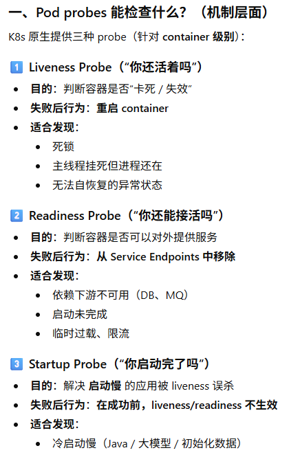
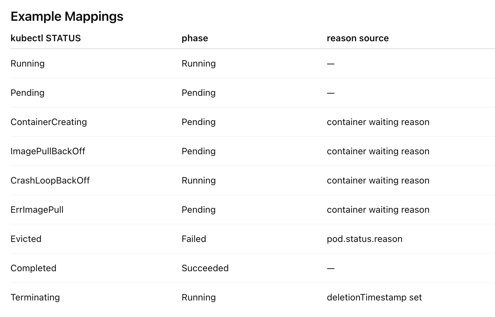

## Pods, Nodes, Containers, Clusters

[Kubernetes 101: Pods, Nodes, Containers, and Clusters | by Daniel Sanche | Google Cloud - Community | Medium](https://medium.com/google-cloud/kubernetes-101-pods-nodes-containers-and-clusters-c1509e409e16)

Hierarchical overview:

```text
Cluster                                       the top-level environment that manages all resources
└── AgentPool(s) / NodePool(s)
    └── Node(s)                               a worker machine in the cluster
└── Namespace(s)                              a logical partition within the cluster
    └── Deployment(s) (spec)                  a higher-level Kubernetes object that manages the lifecycle of pods
        └── ReplicaSet(s)                     automatically created by a deployment
            └── Pod(s)                        the smallest deployable unit in Kubernetes
                └── Container(s)              a lightweight, standalone executable package
    └── Service(s)                            exposes a set of pods as a network service
    └── ConfigMap(s) / Secret(s)              non-sensitive / sensitive configuration data
    └── Ingress                               manages external access to services
```

- Hardware
    - Nodes
        - A [node](https://kubernetes.io/docs/concepts/architecture/nodes/) is the smallest unit of computing hardware in Kubernetes.
        - It is a representation of a single machine in your cluster.
        - Simply view each machine as a set of CPU and RAM resources that can be utilized.
    - The Cluster
        - Nodes pool together their resources to form a more powerful machine.
    - Persistent Volumes
        - To store data permanently, Kubernetes uses [Persistent Volumes](https://kubernetes.io/docs/concepts/storage/persistent-volumes/).
        - Persistent Volumes provide a file system that can be mounted to the cluster, without being associated with any particular node.
- Software
    - Containers
        - Programs running on Kubernetes are packaged as [Linux containers](https://www.docker.com/what-container).
        - Multiple programs can be added into a single container, but you should limit yourself to one process per container if at all possible.
    - Pods
        - Kubernetes doesn’t run containers directly; instead it wraps one or more containers into a higher-level structure called a [pod](https://kubernetes.io/docs/concepts/workloads/pods/pod/).
        - Any containers in the same pod will share the same resources and local network.
        - Containers can easily communicate with other containers in the same pod as though they were on the same machine while maintaining a degree of isolation from others.
        - Pods are used as the unit of replication in Kubernetes.
        - Pods can hold multiple containers, but you should limit yourself when possible.
            - Typically holding only a main process and its tightly-coupled helper containers (these helper containers are typically referred to as “side-cars”).
    - Deployments
        - Pods are not typically directly launched on a cluster.
        - Instead, pods are usually managed by one more layer of abstraction: the [deployment](https://kubernetes.io/docs/concepts/workloads/controllers/deployment/).
        - A deployment’s primary purpose is to declare how many replicas of a pod should be running at a time.
    - Ingress
        - If you want to communicate with a service running in a pod, you have to open up a channel for communication. This is referred to as ingress.
        - The most common ways are by adding either an [Ingress](https://kubernetes.io/docs/concepts/services-networking/ingress/) controller, or a [LoadBalancer](https://kubernetes.io/docs/tasks/access-application-cluster/create-external-load-balancer/).

## Kubernetes Nodepools

[Kubernetes Nodepools explained](https://techcommunity.microsoft.com/blog/coreinfrastructureandsecurityblog/kubernetes-nodepools-explained/2531581)

Nodepools are groups of nodes within a Kubernetes cluster that share the same configuration (CPU, Memory, Networking, OS, etc.). They help manage heterogeneous nodes within a cluster, allowing for different VM sizes or SKUs based on specific needs.

- **System Nodepool**: Used to deploy system pods like CoreDNS and metrics-server. These must run on Linux due to dependencies.
- **User Nodepool**: Used to deploy application pods. These can run on either Linux or Windows nodes and can scale down to zero nodes.

Nodepools help physically isolate system and user application pods, isolate different applications, teams, or environments, and upgrade clusters with less risk.

## About ZeroScaler (Scale-to-Zero)

ZeroScaler and HPA are complementary but serve different purposes:

1. **ZeroScaler**: Scale to/from zero based on request activity
2. **HPA**: Scale based on resource metrics (CPU, memory) when pods > 0

Scaling Logic Flow (the "1 hour" is configurable):

```text
No requests for 1 hour → ZeroScaler scales to 0 pods
↓
New request arrives → ZeroScaler scales to min replicas (usually 1)
↓
High CPU usage → HPA scales up within its min/max bounds
↓
Low CPU usage → HPA scales down to min replicas (but not to 0)
↓
No requests for 1 hour → ZeroScaler takes over and scales to 0
```

The ZeroScaler does NOT scale based on the number of requests - it only does binary scaling:

- **0 pods** when no requests
- **Non-zero pods** when requests exist

The actual scaling based on request volume would be handled by:

1. **HPA with custom metrics** (if configured for request rate)
2. **KEDA** (Kubernetes Event Driven Autoscaler)
3. **Manual replica adjustment**

## Container Probes

A _probe_ is a diagnostic performed periodically by the [kubelet](https://kubernetes.io/docs/reference/command-line-tools-reference/kubelet/) on a container. To perform a diagnostic, the kubelet either executes code within the container, or makes a network request.

### Check mechanisms

- exec
- grpc
- httpGet
- tcpSocket

### Probe outcome

- Success
- Failure
- Unknown: no action should be taken, and the kubelet will make further checks

### Types of probe

- startup probe 启动探针
    - Indicates whether the application within the container is started. All other probes are disabled if a startup probe is provided, until it succeeds.
    - If the startup probe fails, the kubelet kills the container, and the container is subjected to its [restart policy](https://kubernetes.io/docs/concepts/workloads/pods/pod-lifecycle/#restart-policy).
- readiness probe 就绪探针
    - Indicates whether the container is ready to respond to requests.
    - If the readiness probe fails, the EndpointSlice controller removes the Pod's IP address from the EndpointSlices of all Services that match the Pod.
- liveness probe 存活探针
    - Indicates whether the container is running.
    - If the liveness probe fails, the kubelet kills the container, and the container is subjected to its [restart policy](https://kubernetes.io/docs/concepts/workloads/pods/pod-lifecycle/#restart-policy).

- [Liveness, Readiness, and Startup Probes | Kubernetes](https://kubernetes.io/docs/concepts/configuration/liveness-readiness-startup-probes/)
- [Configure Liveness, Readiness and Startup Probes | Kubernetes](https://kubernetes.io/docs/tasks/configure-pod-container/configure-liveness-readiness-startup-probes/)


{.invert-when-dark .invert-soft}

## Resource Requests vs Limits

Requests = what the container is guaranteed to get. The scheduler uses this to decide which node to place the pod on.

Limits = the maximum the container can use. Exceeding CPU limit → throttled; exceeding memory limit → OOMKilled.

Why both?

| Resource | Request                 | Limit                           |
| -------- | ----------------------- | ------------------------------- |
| CPU      | Reserved for scheduling | Hard ceiling (throttled beyond) |
| Memory   | Reserved for scheduling | Hard ceiling (OOMKill beyond)   |

This enables overcommitment — you can pack more pods onto nodes than if every pod reserved its max, while still protecting against runaway processes.

Best Practices

1. Always set requests — without them, pods get "BestEffort" QoS and are evicted first under pressure.
2. CPU: Set request to typical usage, limit to 1.5–2× request (or omit CPU limit entirely — many teams do this since CPU is compressible/throttled, not killed).
3. Memory: Set request ≈ limit (memory is incompressible — exceeding limit = OOMKill). A common ratio is request == limit for memory.
4. Use QoS classes intentionally:
    - Guaranteed (request == limit): critical workloads
    - Burstable (request < limit): most apps
    - BestEffort (no requests/limits): only for disposable jobs
5. Measure first — use kubectl top, Prometheus, or VPA recommendations to set values based on real usage, not guesses.
6. Start conservative, then tune:

```yaml
resources:
  requests:
    cpu: "250m"      # typical usage
    memory: "256Mi"  # typical usage
  limits:
    cpu: "500m"      # allow burst (or omit)
    memory: "256Mi"  # same as request (prevent OOMKill surprises)
```

TL;DR

- Requests = scheduling + guaranteed floor
- Limits = safety ceiling
- Memory: request ≈ limit; CPU: request < limit (or no limit)
- Always measure real usage before setting values

## Pods

### Pod Phase

A Pod's `status` field is a [PodStatus](https://kubernetes.io/docs/reference/generated/kubernetes-api/v1.35/#podstatus-v1-core) object, which has a `phase` field. Possible values for `phase`:

| Value       | Description                                                                                                                                                                                                                                                        |
| ----------- | ------------------------------------------------------------------------------------------------------------------------------------------------------------------------------------------------------------------------------------------------------------------ |
| `Pending`   | The Pod has been accepted by the Kubernetes cluster, but one or more of the containers has not been set up and made ready to run. This includes time a Pod spends waiting to be scheduled as well as the time spent downloading container images over the network. |
| `Running`   | The Pod has been bound to a node, and all of the containers have been created. At least one container is still running, or is in the process of starting or restarting.                                                                                            |
| `Succeeded` | All containers in the Pod have terminated in success, and will not be restarted.                                                                                                                                                                                   |
| `Failed`    | All containers in the Pod have terminated, and at least one container has terminated in failure. That is, the container either exited with non-zero status or was terminated by the system, and is not set for automatic restarting.                               |
| `Unknown`   | For some reason the state of the Pod could not be obtained. This phase typically occurs due to an error in communicating with the node where the Pod should be running.                                                                                            |

Make sure not to confuse _Status_, a kubectl display field for user intuition, with the pod's `phase`. Pod phase is an explicit part of the Kubernetes data model and of the [Pod API](https://kubernetes.io/docs/reference/kubernetes-api/workload-resources/pod-v1/).

```kusto
  NAMESPACE               NAME               READY   STATUS             RESTARTS   AGE
  alessandras-namespace   alessandras-pod    0/1     CrashLoopBackOff   200        2d9h
```

### Kubectl STATUS


{.invert-when-dark .invert-soft}

## Deployment Replicas

[kube-state-metrics/docs/metrics/workload/horizontalpodautoscaler-metrics.md at main · kubernetes/kube-state-metrics](https://github.com/kubernetes/kube-state-metrics/blob/main/docs/metrics/workload/horizontalpodautoscaler-metrics.md)

[kube-state-metrics/docs/metrics/workload/deployment-metrics.md at main · kubernetes/kube-state-metrics](https://github.com/kubernetes/kube-state-metrics/blob/main/docs/metrics/workload/deployment-metrics.md)

```text
┌─────────────────────────────────────────────────────────────────────────────┐
│  1. kube_horizontalpodautoscaler_status_desired_replicas                    │
│     (HPA's control signal — where it WANTS to be)                           │
├─────────────────────────────────────────────────────────────────────────────┤
│  Gap: HPA sync period (~15s), stabilization window,                         │
│       scaleUp/scaleDown behavior policies                                   │
├─────────────────────────────────────────────────────────────────────────────┤
│  2. kube_horizontalpodautoscaler_status_current_replicas                    │
│     (HPA's feedback signal — where it SEES itself now)                      │
├─────────────────────────────────────────────────────────────────────────────┤
│  Gap: Usually zero — HPA reads the scale subresource.                       │
│        Diverges briefly if spec edited manually or                          │
│        HPA hasn't synced yet                                                │
├─────────────────────────────────────────────────────────────────────────────┤
│  3. kube_deployment_spec_replicas                                           │
│     (Deployment's declared desired count)                                   │
│                                                                             │
│     Pod-level: kube_pod_status_phase{phase="Pending"}                       │
│                kube_pod_container_status_waiting_reason                     │
│                  reason=ContainerCreating|ErrImagePull|ImagePullBackOff|    │
│                         CrashLoopBackOff|PodInitializing                    │
│                kube_pod_status_scheduled{condition="true"}  ← scheduled     │
│                kube_pod_status_scheduled{condition="false"} ← unschedulable │
│                kube_pod_status_unschedulable                                │
│                                                                             │
│     These pods exist in the API but aren't Running yet.                     │
│     The gap between spec_replicas and status_replicas lives here.           │
├─────────────────────────────────────────────────────────────────────────────┤
│  Gap: Scheduling latency, node provisioning (cluster                        │
│        autoscaler), ResourceQuota, PVC binding,                             │
│        pod admission webhook rejection                                      │
├─────────────────────────────────────────────────────────────────────────────┤
│  4. kube_deployment_status_replicas                                         │
│     (Total pods created by ReplicaSets — any state)                         │
│                                                                             │
│     Pod-level: ALL pods owned by this Deployment's ReplicaSets              │
│                kube_pod_status_phase{phase="Pending"}   ← waiting           │
│                kube_pod_status_phase{phase="Running"}   ← containers up     │
│                kube_pod_status_phase{phase="Succeeded"} ← (rare for deploy) │
│                kube_pod_status_phase{phase="Failed"}    ← crashed out       │
│                kube_pod_status_phase{phase="Unknown"}   ← node lost         │
│                                                                             │
│     Sum of all phases = status_replicas                                     │
├─────────────────────────────────────────────────────────────────────────────┤
│  Gap: Rolling update in flight — old RS pods still counted                  │
│        but not yet replaced by new-template pods.                           │
│        NOTE: during rollout this can EXCEED spec_replicas                   │
│        (old + new coexist, bounded by maxSurge)                             │
├─────────────────────────────────────────────────────────────────────────────┤
│  5. kube_deployment_status_replicas_updated                                 │
│     (Pods running the LATEST pod template revision)                         │
│                                                                             │
│     Pod-level: kube_pod_status_phase{phase="Running"}                       │
│                  (filtered to latest ReplicaSet)                            │
│                kube_pod_container_status_running                            │
│                kube_pod_container_status_waiting_reason                     │
│                  reason=CrashLoopBackOff ← updated but not healthy          │
│                kube_pod_init_container_status_running                       │
│                kube_pod_init_container_status_waiting                       │
│                                                                             │
│     Pod exists with correct template, but may not be Ready.                 │
├─────────────────────────────────────────────────────────────────────────────┤
│  Gap: Image pull, init containers, app startup,                             │
│        readiness probe failing, CrashLoopBackOff,                           │
│        dependency not reachable                                             │
├─────────────────────────────────────────────────────────────────────────────┤
│  6. kube_deployment_status_replicas_ready                                   │
│     (Pods whose readiness probe is passing RIGHT NOW)                       │
│                                                                             │
│     Pod-level: kube_pod_status_ready{condition="true"}                      │
│                kube_pod_container_status_ready  (per container)             │
│                                                                             │
│     All containers' readiness probes passing → pod Ready condition = True.  │
│     kube_pod_status_ready is the aggregate; container_status_ready is       │
│     per-container (ALL must be true for pod-level Ready).                   │
├─────────────────────────────────────────────────────────────────────────────┤
│  Gap: minReadySeconds not yet elapsed                                       │
│        (pod must stay Ready continuously for N seconds)                     │
├─────────────────────────────────────────────────────────────────────────────┤
│  7. kube_deployment_status_replicas_available                               │
│     (Pods ready long enough to actually receive traffic)                    │
│                                                                             │
│     Pod-level: kube_pod_status_ready{condition="true"}                      │
│                  AND age since last transition > minReadySeconds            │
│                                                                             │
│     No separate pod-level metric for this — it's a Deployment controller    │
│     calculation. If minReadySeconds=0 (default), this equals layer 6.       │
├─────────────────────────────────────────────────────────────────────────────┤
│  Gap: Pod registered in Endpoints/EndpointSlice but                         │
│        kube-proxy / service mesh hasn't programmed                          │
│        iptables/IPVS rules yet                                              │
├─────────────────────────────────────────────────────────────────────────────┤
│  8. kube_endpoint_address_available                                         │
│     (Pods actually in the Service's Endpoints object —                      │
│      reachable by other pods via the Service)                               │
│                                                                             │
│     Pod-level: kube_pod_status_ready{condition="true"}                      │
│                  AND listed in Endpoints/EndpointSlice                      │
│                kube_endpoint_address_not_ready ← Ready but not yet routable │
│                                                                             │
│     The Endpoints controller watches pod Ready condition and adds/removes   │
│     pod IPs. kube-proxy then programs iptables/IPVS.                        │
└─────────────────────────────────────────────────────────────────────────────┘
```

| No. | Metric                           | Answers                              | Domain     |
| --- | -------------------------------- | ------------------------------------ | ---------- |
| 1   | `..._desired_replicas`           | How many does HPA want?              | HPA        |
| 2   | `..._current_replicas`           | How many does HPA see?               | HPA        |
| 3   | `..._spec_replicas`              | How many did the Deployment ask for? | Deployment |
| 4   | `..._status_replicas`            | How many pods exist (any state)?     | Deployment |
| 5   | `..._replicas_updated`           | How many are on the latest template? | Deployment |
| 6   | `..._replicas_ready`             | How many are passing readiness?      | Deployment |
| 7   | `..._replicas_available`         | How many are ready long enough?      | Deployment |
| 8   | `..._endpoint_address_available` | How many are actually routable?      | Service    |

> Layer 4 (`status_replicas`) can temporarily **exceed** layer 3 (`spec_replicas`) during a rolling update — old and new pods coexist up to `maxSurge`. Every other layer is ≤ the one above it.

- **Top** (layer 1) minus **Bottom** (layer 7 or 8) = your **total scaling latency gap**
- If this gap persists beyond your SLA, you're under-provisioned during the scaling event

| Layer | Deployment-level metric | Pod-level equivalent                       | Key pod metric to debug the gap                                         |
| ----- | ----------------------- | ------------------------------------------ | ----------------------------------------------------------------------- |
| 3→4   | spec vs status_replicas | `phase=Pending` count                      | `kube_pod_status_unschedulable`, `container_status_waiting_reason`      |
| 4→5   | status vs updated       | `phase=Running` on old RS                  | Filter pods by ReplicaSet label to find old-template stragglers         |
| 5→6   | updated vs ready        | `kube_pod_status_ready{condition="false"}` | `kube_pod_container_status_ready` per container to find the failing one |
| 6→7   | ready vs available      | (no pod metric)                            | Deployment's `minReadySeconds` config                                   |
| 7→8   | available vs endpoint   | `kube_endpoint_address_not_ready`          | Endpoints controller lag, `publishNotReadyAddresses` on Service         |

The lifecycle of a single pod mapped to layers:

```text
Pod created          → counted in layer 4 (status_replicas)
  phase=Pending      → gap between layer 3 and 4 if not yet scheduled
  phase=Running      → now in layer 4, working toward layer 5
  all containers up  → counted in layer 5 (updated, if latest template)
  readiness=true     → counted in layer 6 (ready)
  age > minReady     → counted in layer 7 (available)
  in Endpoints       → counted in layer 8 (routable)
```

## Kubectl

### Use Non-Default Config

```shell
# Per-command
kubectl --kubeconfig ~/.kube/config.lumina-dev-westus3 get pods

# Or set for the session
export KUBECONFIG=~/.kube/lumina-dev-config

# To use both configs simultaneously:
export KUBECONFIG=~/.kube/config:~/.kube/config.lumina-dev-westus3
kubectl config get-contexts
kubectl config use-context xxx
```

```powershell
$env:KUBECONFIG = "$HOME\.kube\config;$HOME\.kube\config.lumina-dev-westus3"
```

### Get Deployment's Docker Image

```bash
kubectl --kubeconfig ~/.kube/config.devuscl1 -n mmi-7 get deployment dep--mmi-endpoint -o yaml | grep image
#> image: aicpppe.azurecr.io/microsoft/cognitive-services-mmi-service-endpoint:20260422.16-e39aeeb0-buddy

kubectl -n lumina-agent-c get deployment lumina-api-c-2 -o yaml | grep image
#> image: luminadevaks.azurecr.io/devaks/lumina-api:20260728.8-1es-westus3-c-2-fcba46-2607-lumina-rai
```
